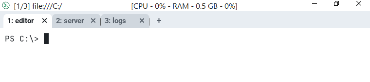
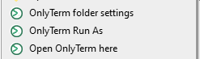
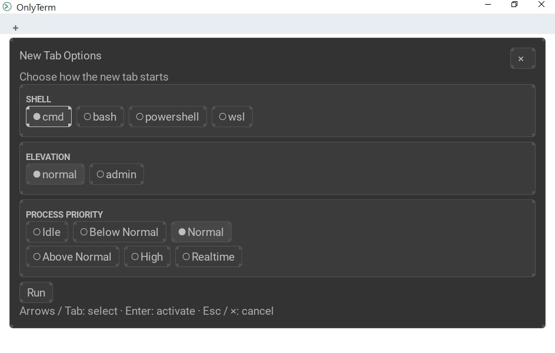
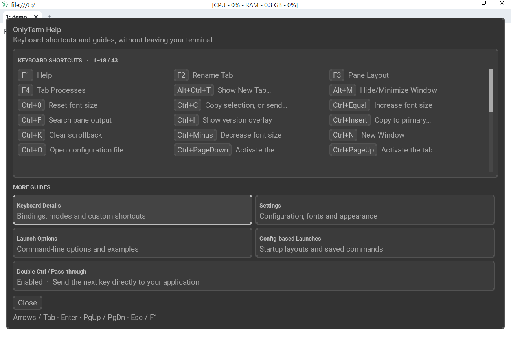

# OnlyTerm

[](LICENSE.md)
[](https://github.com/PHPCraftdream/OnlyTerm)
[](https://www.rust-lang.org/)
[](https://www.rust-lang.org/)
[](https://github.com/PHPCraftdream/OnlyTerm/releases/latest)
[](https://github.com/PHPCraftdream/OnlyTerm/commits/main)
[](https://github.com/PHPCraftdream/OnlyTerm/issues)
[](https://github.com/PHPCraftdream/OnlyTerm/stargazers)

OnlyTerm is a GPU-accelerated terminal emulator for Windows with tabs, split panes and startup layouts. It is in alpha: releases are named `v0.0.N-alpha`.

It is a fork of [wezterm/wezterm](https://github.com/wezterm/wezterm) focused on stability and ease of use on Windows. The macOS/Linux (X11, Wayland) backends and packaging that upstream ships have been removed, since those platforms already have plenty of good terminals — Windows didn't have a great one.



## What it does

* **Tabs and panes** for `cmd`, PowerShell, bash and WSL, with a shell / elevation / process priority chooser for every new tab (including admin tabs).
* **Startup layouts**: a small [ktav](docs/migration-to-ktav.md) file describes a set of tabs, each with its own title, directory, environment and commands. Open it from Explorer (`*.onlyterm-run`) or with `onlyterm start --start-conf`.
* **Explorer integration**: *Open OnlyTerm here*, *OnlyTerm Run As* and *OnlyTerm folder settings* in the folder context menu.
* **Built-in help and dialogs on F1–F4**: shortcuts and guides, tab rename, pane layout, tab processes (see [Function keys](#function-keys)).
* **Multiplexer**: tabs, panes, windows and workspaces are managed by OnlyTerm itself (see [What is the multiplexer?](#what-is-the-multiplexer)).
* **Resource usage in the title bar**: CPU and RAM use of the window's whole process tree, refreshed every 5 seconds while the window is focused.
* **Configuration** in a single [ktav](docs/migration-to-ktav.md) file, `%USERPROFILE%\.onlyterm.ktav`, with hot reloading: fonts, color schemes, key bindings, launch menu.
* **Modern terminal protocols** inherited from upstream: Kitty graphics and keyboard, iTerm2 images (`onlyterm imgcat`), OSC 52 clipboard, synchronized output, hyperlinks, ligatures, color emoji.
* **Serial ports**: `onlyterm serial COM3 --baud 115200`.
* **100% Rust**: no bundled C library in the runtime binaries (the only C/C++ touched in the build is a build-time helper that locates the MSVC toolchain).

## Installation

Windows 10 version 1809 (build 17763) or later, 64-bit (x64).

Download the latest release from the [Releases page](https://github.com/PHPCraftdream/OnlyTerm/releases/latest):

* `OnlyTerm-<version>-setup.exe` — installer (adds OnlyTerm to `PATH`, registers the Explorer menu entries and the `.onlyterm-run` file type);
* `OnlyTerm-windows-<version>.zip` — portable build: extract anywhere and run `onlyterm-gui.exe`. No Explorer integration.

### Build from source

Install Rust with the MSVC toolchain, then:

```
git clone https://github.com/PHPCraftdream/OnlyTerm.git
cd OnlyTerm
cargo build --release
target\release\onlyterm-gui.exe
```

`target\release\onlyterm.exe` is the command-line front end (`onlyterm start`, `onlyterm cli`, ...). No other dependencies are required. See [docs/install/source.md](docs/install/source.md).

## Launching

`onlyterm start` and `onlyterm-gui start` open a window; global options go **before** `start`.

```console
onlyterm start                                  # your default shell
onlyterm start -- powershell.exe -NoLogo        # a program instead of the shell
onlyterm start --cwd C:/work                    # initial directory
onlyterm start --choose-tab --cwd C:/work       # pick shell / elevation / priority first
onlyterm start --start-conf project.onlyterm-run  # a startup layout (several tabs)
onlyterm start --workspace dev                  # open in the "dev" workspace
onlyterm start --position 100,100               # initial window position
onlyterm start --always-new-process             # do not reuse a running GUI process

onlyterm --config font_size=14 start            # override a setting (repeatable)
onlyterm --config-file D:/cfg/other.ktav start  # use another config file
onlyterm --skip-config start                    # built-in defaults only

onlyterm serial COM3 --baud 115200              # a serial port
onlyterm ls-fonts --list-system                 # fonts OnlyTerm can see
onlyterm show-keys                              # current key assignments
```

`onlyterm start --help` lists every option; see also [docs/cli/start.md](docs/cli/start.md) and the [launch guide](docs/launching.md).

### From Explorer



| Entry (right-click a folder, a drive, or the empty space in a folder) | What it does |
| --- | --- |
| **Open OnlyTerm here** | Opens a window in that folder. If the folder has a run file, starts its layout instead of a single tab. |
| **OnlyTerm Run As** | Opens the *New Tab Options* dialog first, then starts the chosen shell in that folder. |
| **OnlyTerm folder settings** | Creates the folder's run file if it is missing and opens it in Notepad++ (Notepad if it is not installed). |
| Double click a `*.onlyterm-run` file | Opens that startup layout. |



### Startup layouts

A layout is a ktav file; `project.onlyterm-run` for the window at the top of this page:

```
root_dir: C:\src\my-project
shell: powershell
tabs: [
  { title: editor }
  { title: server, commands: [npm run dev] }
  { title: logs, root_dir: logs }
]
```

`root_dir`, `shell`, `priority`, `admin`, `vars` and `commands` can be set once at the top and overridden per tab. A relative `root_dir` is resolved against the layout file. Only use layouts you trust: `commands` are typed into the tab's shell. Details: [docs/cli/start.md](docs/cli/start.md).

## Handy shortcuts

Press **F1** to see all of them, including your own bindings.

| Key | Action |
| --- | --- |
| **Ctrl+T** / **Ctrl+W** | New tab / close the current tab |
| **Alt+Ctrl+T** | New Tab Options (shell, elevation, priority) |
| **Ctrl+N** | New window |
| **Ctrl+F** | Search the pane output |
| **Ctrl+Shift+P** | Command palette (includes your `launch_menu` entries) |
| **Ctrl+C** / **Ctrl+V** | Copy the selection (or send Ctrl+C) / paste |
| **Ctrl+Plus**, **Ctrl+Minus**, **Ctrl+0** | Increase, decrease, reset the font size |
| **Ctrl+K** | Clear scrollback |
| **Ctrl+O** | Open the config file |
| **Ctrl+I** | Show the version overlay |

## Function keys

| Key | Opens |
| --- | --- |
| **F1** | Help: keyboard shortcuts and guides (launch options, config-based launches). |
| **F2** | Rename the current tab. An empty title restores the automatic one. |
| **F3** | Pane layout: split left/right, top/bottom, into three columns or rows, close the active pane. |
| **F4** | Tab processes: detach child processes, or end them together with their process trees. |



More about each dialog, with screenshots: [docs/function-keys.md](docs/function-keys.md).

## What is the multiplexer?

A terminal multiplexer is the part of a terminal that owns your tabs, panes and windows. In tmux or screen it runs inside a terminal; in OnlyTerm it is built into the application and drawn natively, so the mouse, the clipboard and scrollback work as in any Windows program.

It is still here, and it is the reason for much of what OnlyTerm can do:

* tabs, split panes, windows and named **workspaces** (`onlyterm start --workspace NAME`);
* **mux domains** — a set of tabs that can live in another process or on another host; `onlyterm connect DOMAIN` attaches to one, and `onlyterm-mux-server.exe` is the server side;
* **`onlyterm cli`** — list, spawn, split and send text to panes of a running instance from a script.

For everyday use you do not need to know any of this: open OnlyTerm and use tabs. [docs/multiplexing.md](docs/multiplexing.md) covers domains.

## Configuration

Press **Ctrl+O** to open the config file, or create `%USERPROFILE%\.onlyterm.ktav`:

```
initial_cols: 120
initial_rows: 28
font_size: 11.0
color_scheme: AdventureTime
```

The reference is in [docs/config](docs/config/files.md). Coming from `.wezterm.lua`? See the [migration guide](docs/migration-to-ktav.md).

## Logs

Each OnlyTerm process writes `onlyterm-gui.exe-log-<pid>.txt` to `.local\share\onlyterm` in your home directory. Set `ONLYTERM_LOG=debug` for more detail. Every window process also records a `memory:` line every 10 minutes.

## What this fork focuses on

This is built on the wezterm/wezterm codebase, with a set of real-world bug and stability fixes ported in — primarily ones affecting Windows: GUI hangs and crashes under load, ConPTY-related races, correctness of pane resize/split handling, input and scroll responsiveness, keyboard-layout-independent standard key bindings, and video memory use. Each window renders in its own helper process, so the main process normally holds no GPU device. The internal naming of the code (crate names, environment variables, system identifiers) has been renamed to OnlyTerm branding; the upstream copyright and license attribution are preserved unchanged.

Release notes: [docs/changelog.md](docs/changelog.md).

## Getting help

Use the [issue tracker of this repository](https://github.com/PHPCraftdream/OnlyTerm/issues) for questions, bug reports and ideas. Press **F1** inside OnlyTerm for the built-in help.

## Attribution and license

This project is a fork of [wezterm/wezterm](https://github.com/wezterm/wezterm), created and maintained by [Wez Furlong](https://github.com/wez) and upstream contributors. The original project's license and copyright are preserved unchanged — see [LICENSE.md](LICENSE.md).
