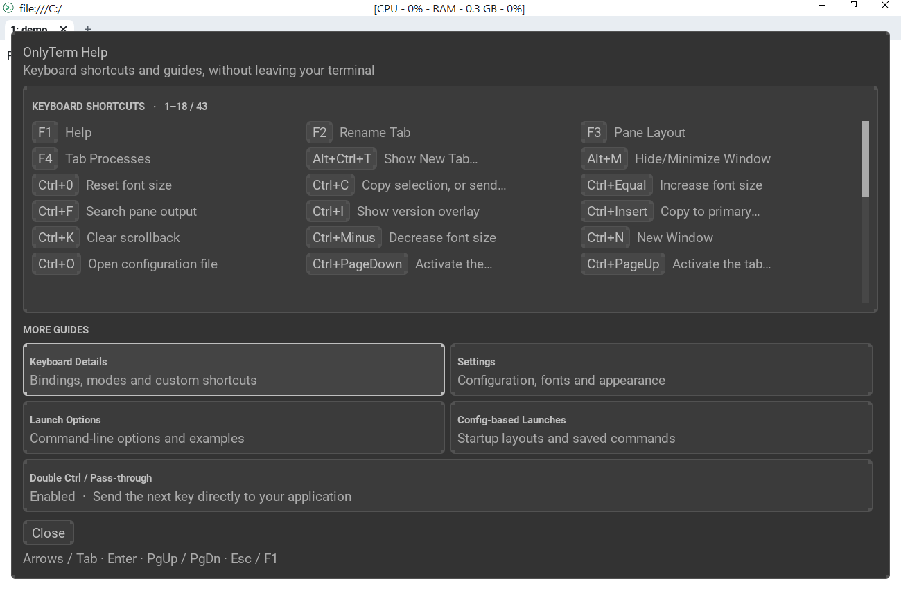
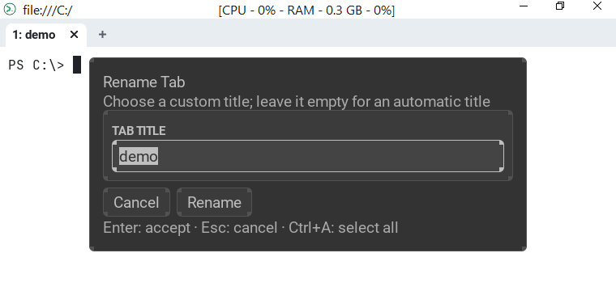
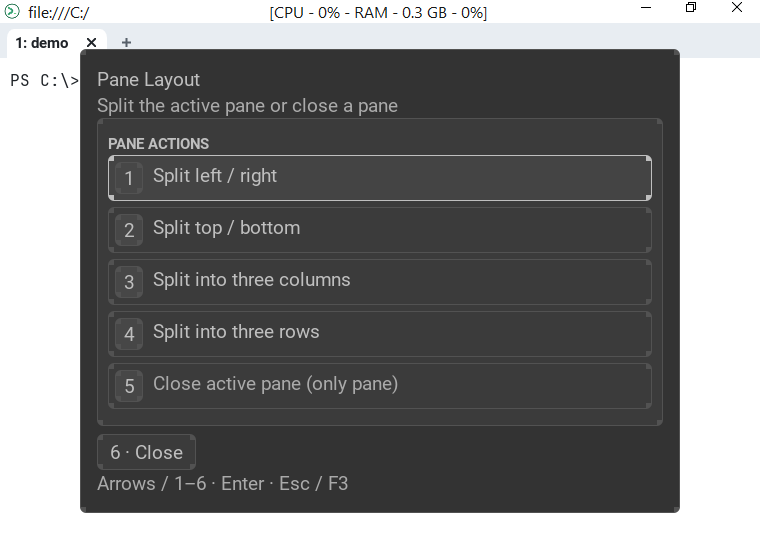
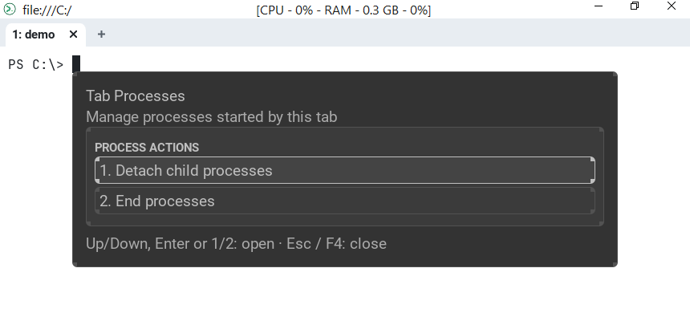
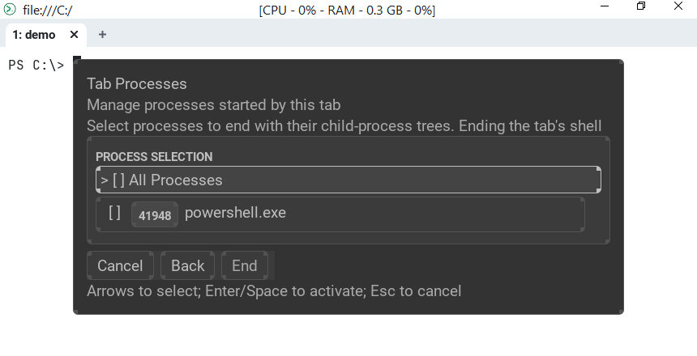
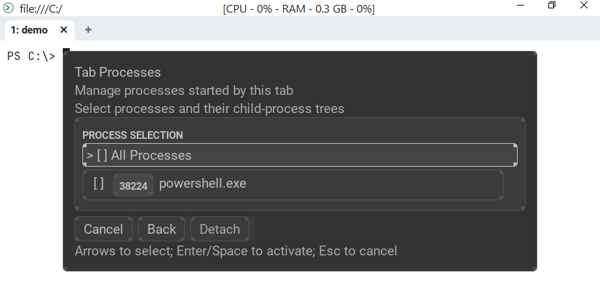

# Function keys: F1–F4

OnlyTerm binds the first four function keys to its own dialogs. They are drawn
inside the window, work with the keyboard and the mouse, and close with
**Esc** (or the same key again).

| Key | Dialog | Command name |
| --- | --- | --- |
| **F1** | Help | `ActivateHelpMenu` |
| **F2** | Rename Tab | `RenameCurrentTab` |
| **F3** | Pane Layout | `ActivatePaneLayoutMenu` |
| **F4** | Tab Processes | `ActivateTabProcessMenu` |

The bindings can be changed like any other: see [Key Binding](config/keys.md).

## F1 — Help

Shows the current keyboard shortcuts (including your own bindings) and five
guides:

* **Keyboard Details** — bindings, modes and custom shortcuts;
* **Settings** — configuration, fonts and appearance;
* **Launch Options** — command-line options and examples;
* **Config-based Launches** — startup layouts and saved commands;
* **Double Ctrl / Pass-through** — send the next key straight to the running
  application.

Navigate with the arrow keys, **Tab**, **PgUp**/**PgDn**; **Enter** opens a
guide; **Esc** or **F1** closes the window. Text in a guide can be selected and
copied.

## F2 — Rename Tab

Opens a title editor with the current custom title selected. **Enter** renames
the tab, **Esc** cancels, **Ctrl+A** selects all. An empty title restores the
automatic title. Clicking a tab does not open this dialog.

## F3 — Pane Layout

Numbered actions for the active pane; press the digit or move with the arrow
keys and press **Enter**:

1. Split left / right
2. Split top / bottom
3. Split into three columns
4. Split into three rows
5. Close the active pane (unavailable when it is the only pane)
6. Close the dialog

## F4 — Tab Processes

Manages the processes started by the current tab. Local processes only.

1. **Detach child processes** — select processes and their child-process trees
   to detach from the tab, so that they keep running after the pane or window is closed.
2. **End processes** — select processes to end together with their
   child-process trees. Ending the tab's shell closes the tab.

Both pages show the processes as a tree with a checkbox for each one and an
**All Processes** row; **Enter** or **Space** toggles a row, then press the
**Detach** / **End** button.

