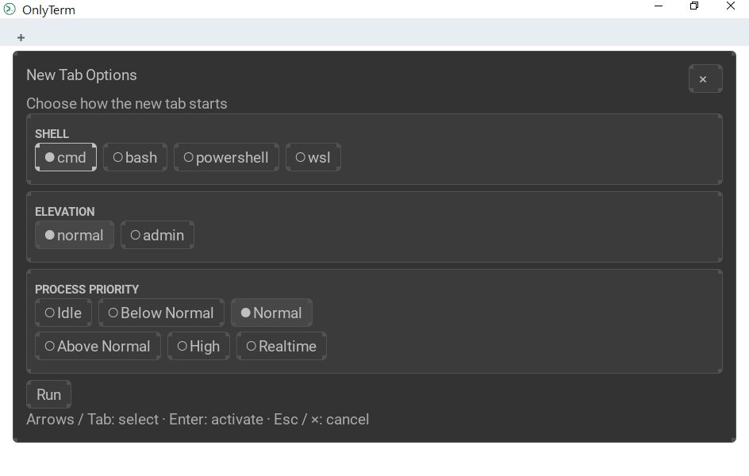
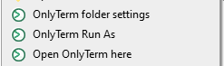
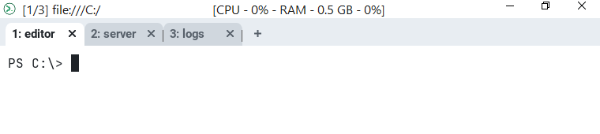

# Launching OnlyTerm

OnlyTerm can be started from the Start menu, from a shell, from Explorer, or
from a saved startup layout. This page lists the ways, with examples.

## From a shell

`onlyterm start` and `onlyterm-gui start` open a window. Options that apply to
the whole program (`--config-file`, `--skip-config`, `--config`) go **before**
`start`; options of the window go after it.

```console
$ onlyterm start                                  # your default shell
$ onlyterm start -- powershell.exe -NoLogo        # run a program instead
$ onlyterm start --cwd C:/work                    # initial directory
$ onlyterm start --choose-tab --cwd C:/work       # pick shell / elevation / priority first
$ onlyterm start --start-conf project.onlyterm-run  # a startup layout
$ onlyterm start --workspace dev                  # open in the "dev" workspace
$ onlyterm start --position 100,100               # initial window position
$ onlyterm start --always-new-process             # do not reuse a running GUI process
```

Global options:

```console
$ onlyterm --config font_size=14 start            # override one setting (repeat for more)
$ onlyterm --config-file D:/cfg/other.ktav start  # use another config file
$ onlyterm --skip-config start                    # built-in defaults only
```

Other commands:

```console
$ onlyterm serial COM3 --baud 115200              # a serial port
$ onlyterm connect NAME                           # attach to a multiplexer domain from your config
$ onlyterm ls-fonts --list-system                 # fonts OnlyTerm can see
$ onlyterm show-keys                              # current key assignments
```

The complete option list of `start` is in [onlyterm start](cli/start.md).

### `--position`

```
--position 10,20          x=10, y=20 in screen coordinates
--position screen:10,20   the same
--position main:10,20     relative to the main monitor
--position active:10,20   relative to the active monitor
```

### `--choose-tab`

Opens the *New Tab Options* dialog instead of the first tab. The tab is started
only after you choose a shell and press **Run**; closing the dialog (Esc or the
cross) exits, because there is nothing behind it. `--cwd` is allowed with it and
sets where the chosen shell starts. `--choose-tab` cannot be combined with a
program or `--start-conf`.



The same dialog opens inside a running window with **Alt+Ctrl+T**, or by
right-clicking the **+** button. Choosing *admin* shows a Windows UAC prompt.

## From Explorer



The installer adds entries to the context menu of a folder, of a drive, and of
the empty space inside a folder:

| Entry | Command it runs | What it does |
| --- | --- | --- |
| **Open OnlyTerm here** | `onlyterm-gui start --no-auto-connect --cwd "<folder>"` | Opens a window in that folder. If the folder has a run file, its layout is started instead. |
| **OnlyTerm Run As** | `onlyterm-gui start --no-auto-connect --choose-tab --cwd "<folder>"` | Opens *New Tab Options*, then starts the chosen shell in that folder. |
| **OnlyTerm folder settings** | `onlyterm-gui folder-settings "<folder>"` | Creates the folder's run file if there is none, and opens it in Notepad++ (Notepad if it is not installed). |

Double-clicking a `*.onlyterm-run` file opens it as a startup layout.

The entries are registered by the installer. The zip build does not register
them.

## Startup layouts and run files

A startup layout opens a fixed set of tabs. It is a [ktav](migration-to-ktav.md)
file, passed with `--start-conf`; a `*.onlyterm-run` file is the same thing, so
Explorer can open it.

```
root_dir: C:\src\my-project
shell: powershell
tabs: [
  { title: editor }
  { title: server, commands: [npm run dev] }
  { title: logs, root_dir: logs }
]
```



| Field | Meaning |
| --- | --- |
| `root_dir` | Directory the tab starts in. A relative path is resolved against the layout file, not against the current directory. |
| `shell` | `cmd`, `powershell`, `bash` or `wsl`. |
| `priority` | Process priority, for example `Normal`. |
| `admin` | `true` starts the tab elevated (a UAC prompt per tab). |
| `vars` | Extra environment variables. Merged per key; a tab's value wins. |
| `commands` | Lines typed into the shell once it starts. Top-level commands run before a tab's own. |
| `tabs` | The tabs, in order, each with an optional `title` and the same fields as above. At least one is required. |

Notes:

* `--start-conf` cannot be combined with a program, `--cwd` or `--choose-tab`.
* Commands are queued as shell input. There is no prompt detection, so an
  interactive program can swallow the commands queued after it: put such a
  command last.
* Only open layouts you trust: `commands` can run any program.

OnlyTerm keeps a `.onlyterm-run` folder beside the config file
(`%USERPROFILE%\.onlyterm-run`). *OnlyTerm folder settings* puts a run file for a
folder there, made from `.onlyterm-run\template.ktav`, which you can edit.
More in [onlyterm start](cli/start.md#run-files-opening-a-layout-from-explorer).

## From the configuration

The main config (`%USERPROFILE%\.onlyterm.ktav`) decides what a normal launch
opens:

```
default_prog: [powershell.exe, -NoLogo]
default_cwd: C:/work
set_environment_variables: { PROJECT: demo }

launch_menu: [
  { label: Project, args: [powershell.exe, -NoLogo], cwd: C:/work }
]
```

`launch_menu` entries show up in the command palette (**Ctrl+Shift+P**).
See [Launching Programs](config/launch.md).

## Help inside the program

**F1** opens the help window; its *Launch Options* and *Config-based Launches*
guides contain the same examples. See [Function keys](function-keys.md).
